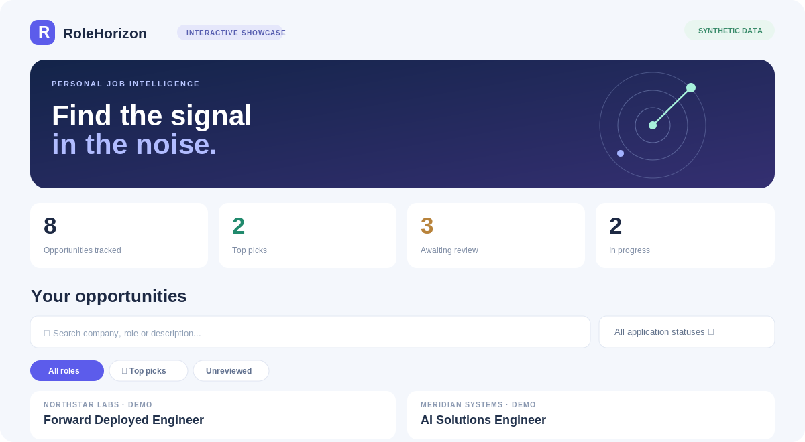
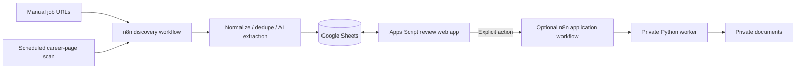

<div align="center">

<a href="https://stephanboner.github.io/rolehorizon/">
  
</a>

# RoleHorizon
**Find the signal in the job-market noise.**

A personal job intelligence platform: discover roles across career pages, extract structured information, manage a shortlist, and optionally prepare application documents.

**[Launch the live demo](https://stephanboner.github.io/rolehorizon/) · [Installation guide](docs/SETUP.md) · [Architecture](docs/ARCHITECTURE.md) · [Security](SECURITY.md)**

</div>

> **Public, reproducible starter based on a real private personal project.** Its integrations require your own accounts, credentials, and Google Sheet. The public browser demo uses fictional records; no applications are submitted automatically.

## What it does

| Discover | Normalize | Review | Prepare (optional) |
| --- | --- | --- | --- |
| Paste job links or run a daily scan of selected career pages | Deduplicate links, retrieve available job content, run structured AI extraction | Search and filter vacancies, assign priorities, add notes and track progress | Explicitly request a document-drafting workflow connected to a private Python worker |

The goal is a transparent **human-in-the-loop** workflow, not indiscriminate mass applications.

## Try the live interactive demo

**[Launch RoleHorizon in your browser →](https://stephanboner.github.io/rolehorizon/)**

The hosted demo is a **working frontend, not a screenshot**: search fictional roles, filter your shortlist, update ratings and notes, and explore application statuses. It runs entirely in your browser with **synthetic data**—no Google Sheet, n8n instance, API key or login is required. Changes are temporary and reset when you reload. Job ingestion, scheduled scans and application-document generation require the separately configured backend.

The demo is hosted with **GitHub Pages** from [`docs/index.html`](docs/index.html). To run that same demo locally instead:

```bash
python3 -m http.server 8000 --directory docs
# Open http://localhost:8000
```

## Repository contents

| Path | Purpose | Deployable? |
| --- | --- | --- |
| [`templates/`](templates/) | Exact CSV headers for the three required Google Sheets tabs | **Yes** — can be imported or created automatically |
| [`apps-script/`](apps-script/) | Complete private review web app, backend and non-destructive Sheets initializer | **Yes**, after supplying Script Properties |
| [`automation/job-discovery.json`](automation/job-discovery.json) | 16-node n8n workflow for manual intake, scheduled career scanning, AI extraction and Sheets writing | **Yes**, after configuring your Google Sheet, credentials and testing |
| [`automation/company-source-research.json`](automation/company-source-research.json) | 5-node n8n workflow for AI-assisted discovery of official career pages | **Yes**, after configuring authentication and AI |
| [`automation/application-preparation-optional.json`](automation/application-preparation-optional.json) | 13-node workflow for explicitly requested draft preparation | **Optional**, requires private worker and file storage |
| [`worker/`](worker/) | Python/FastAPI document worker with Docker build and URL fetch safeguards | **Optional**, requires a private rclone remote |
| [`docs/`](docs/) | [Live interactive demo](https://stephanboner.github.io/rolehorizon/), source, setup and architecture notes | **Yes** — hosted on GitHub Pages |

**Important:** Workflows are deliberately **inactive on import**, and all credential bindings were removed from the export. The templates are derived from a working personal installation, but **a newly imported deployment has not been end-to-end verified**. Complete and test all setup steps before activation.

## Architecture



## Start here

1. **Create a fresh Google Sheet**, add `ROLEHORIZON_SHEET_ID` in the new Apps Script project's Script Properties, and run `setupRoleHorizonWorkbook()`. The initializer creates the tabs `Stellen`, `Firmenquellen`, and `Scanprotokoll` with their required headers and review dropdowns.
2. **Import the n8n workflows as inactive**, connect your Google Sheets and OpenAI credentials and replace the placeholder spreadsheet ID throughout.
3. **Configure the private Apps Script project** using the files in `apps-script/` and the Script Properties listed in the guide.
4. **Test manually**, then publish the Apps Script web app with access restricted to yourself. Enable the schedule only after a successful manual run.

Full instructions, including a configuration table, troubleshooting and optional Docker worker deployment: **[docs/SETUP.md](docs/SETUP.md)**.

## Why the implementation is interesting

- **URL canonicalization** preserves job identifiers while stripping tracking parameters, allowing duplicate-safe ingestion.
- **Explicit field ownership** keeps manual notes, assessments and application state separate from scraped/AI-generated content.
- **Optimistic concurrency** uses SHA-256 fingerprints to reject stale writes, while Apps Script's `LockService` serializes sensitive mutations.
- **Human approval** gates company-source activation and application preparation.
- **Status transparency** distinguishes accepting a preparation request from producing documents or actually applying.
- **Credential isolation** keeps workflow secrets in n8n and Apps Script Script Properties, not in browser code.

The full workflow exports and application code are provided for inspection and adaptation. The [security notes](SECURITY.md) explain important limits of this lightweight architecture.

## Stack

JavaScript · Google Apps Script · Google Sheets · n8n · OpenAI API · Python · FastAPI · Docker (optional).

## Scope and limitations

RoleHorizon is a **single-user personal tool**, not a supported multi-tenant SaaS product. Some ATS providers and JavaScript-driven job pages may reject automated retrieval. AI-extracted descriptions require human review. Scheduled scanning can generate API costs; scraping must comply with the target sites' terms. The example intentionally includes no private account IDs, access tokens, CVs, real application history, or production webhooks.

**Ownership:** Independently developed as a personal engineering project. The code in this public repository is a sanitized, configurable adaptation of a private deployment. No open-source license has been granted; please contact the author before reusing or redistributing the code.
