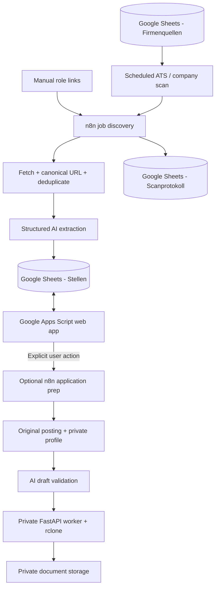

# System architecture and responsibilities

RoleHorizon is a **single-user job intelligence pipeline**, not an autonomous application agent.

## Interfaces and data contracts

- **`Stellen`** is the canonical database: A–E imported fields, F–H person-maintained fields, I original role link, J optional trigger, K–M preparation outcomes.
- **`Firmenquellen`** stores approved company board URL and scanning platform; the source discovery model only proposes candidates.
- **`Scanprotokoll`** records scan outcomes. No critical decisions should be made solely from these logs without checking the source.
- **n8n import** contains three separately named, initially inactive workflows. The first has **16 nodes**, the source research workflow **5**, and the optional application preparation workflow **13** (adapted from their respective published personal versions).
- **Apps Script** runs as the deployer and is restricted to that account. `getJobs` reads all records; `saveJob`, `deleteJob` and `bulkArchiveDisplayedJobs` use URL identity, revision checks and script locks.
- **Python worker** is optional. It offers guarded original-job retrieval, profile loading and document storage, and requires a private token plus rclone remote.

## Key engineering decisions

### Link normalization and duplicate safety

An ATS position may use query parameters such as `jobId` to identify a unique role. Removing all parameters could merge unrelated jobs. RoleHorizon removes common tracking parameters but preserves meaningful job identifiers and checks the canonical link against existing sheet rows.

### Safe writes to an editable spreadsheet

Google Sheets does not offer database transactions. The app combines a canonical original job link, SHA-256 revision fingerprints, field-level writes and `LockService` to reduce accidental overwrites after a sheet sort or concurrent edit. These safeguards are **not** equivalent to a transactional database.

### Structured AI output is not authority

An extraction is marked complete only if mandatory fields exist. Unreadable or blocked job pages are marked for human review; the model is not allowed to fabricate missing source text as evidence. The company-source search returns a proposal that must be confirmed before adding it.

### Preparation is not applying

The optional application workflow is user-initiated and creates **drafts** only. The UI differentiates the initial webhook acceptance from document creation. No code in this starter submits applications to employers.

## Explicit limits

This implementation intentionally uses Google Sheets for fast iteration and low single-user operational complexity. Provider HTML and API surfaces change, and the system has not been benchmarked for extraction recall, accuracy, scale, or hours saved. Treat it as a practical engineering project, not a production-grade applicant tracking SaaS.
